<div align="center">
  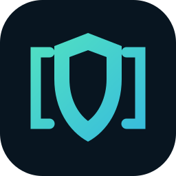
  <h1>MCP Sentinel</h1>
  <p><strong>Security, policy enforcement, approvals, and observability for MCP connections.</strong></p>
  <p>
    <a href=".github/workflows/ci.yml"></a>
    <a href="tests"></a>
    <a href=".github/workflows/security.yml"></a>
    <a href="docker-compose.yml"></a>
    <a href="LICENSE"></a>
    <a href="docs/PROTOCOL_SUPPORT.md"></a>
    <a href="CHANGELOG.md"></a>
  </p>
</div>

> [!IMPORTANT]
> MCP Sentinel reduces risk by enforcing policies, inspecting traffic, and requiring human approval for sensitive actions. It does not guarantee that an MCP client, server, model, or tool is safe.

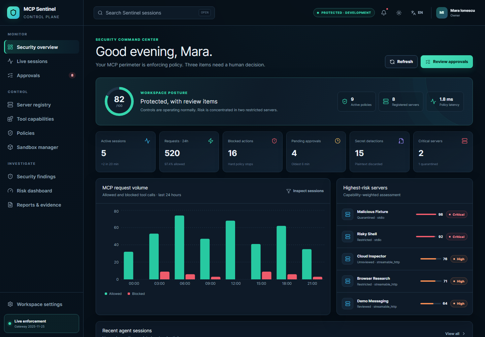

## Why MCP Sentinel exists

MCP gives agents useful capabilities, but those capabilities can read files, run commands, call networks, mutate databases, send messages, or deploy software. A tool description is helpful context—not a security boundary. Once a client can invoke a side-effecting tool, the server, its package, its data, and the model’s decision-making all become part of the risk surface.

MCP Sentinel sits between an MCP client and server. It validates protocol frames, applies deterministic policy, calculates explainable contextual risk, pauses sensitive requests for a human, inspects responses, removes credential-shaped content, and stores a sanitized, tamper-evident audit trail. Untrusted local servers can be launched with a restrictive Docker profile.

```text
MCP Client
→ Sentinel Gateway
→ Policy Evaluation
→ Risk Analysis
→ Optional Human Approval
→ MCP Server
→ Response Inspection
→ Audit Trail
```

No paid API is required. The demo is deterministic, synthetic, and local-first.

## Capabilities

- **Real MCP gateway.** Go data plane with supervised stdio and Streamable HTTP POST/GET/DELETE proxy modes, hard payload limits, preserved request IDs, timeouts, Origin validation, and fail-closed control-plane calls.
- **Deterministic policy engine.** Versioned Sentinel YAML supports tool, method, argument, environment, path, command, limits, transformation, response-redaction, approval, deny, and termination decisions with a complete rule trace.
- **Human approval.** Pending requests are persisted, expire safely, survive gateway restarts, and resolve atomically through optimistic concurrency. Reviewers can approve once, approve modified arguments, deny, or escalate.
- **Explainable risk.** Weighted signals cover shell access, writes, destructive behavior, secret paths, networks, database mutations, deployments, messaging, encoded content, server trust, and repeated denials.
- **Secret protection.** Pattern and entropy detection replaces API keys, private keys, bearer tokens, JWTs, database URLs, cloud credentials, and sensitive fields. Findings retain fingerprints—not plaintext.
- **Suspicious-content warnings.** Source-aware static and encoded-content heuristics flag instruction overrides, policy bypasses, exfiltration requests, impersonation, and forced tool calls. They never grant access or override deterministic policy.
- **Resource guards.** Canonical path containment, sensitive-path blocking, executable and command-prefix allowlists, shell-chain detection, public-network allowlists, DNS/IP checks, and redirect revalidation primitives.
- **Sandbox manager.** Non-root Docker containers, read-only roots, tmpfs, dropped capabilities, `no-new-privileges`, PIDs/memory/CPU limits, network disabled by default, controlled mounts, image digests, lifecycle records, and cleanup.
- **Investigation console.** Next.js dashboard, registry, policy tester, session timeline, raw sanitized payload view, approval review, risk explanations, redactions, injection warnings, sandbox status, replay simulation, reports, and settings.
- **Replay and evidence.** Simulation-only policy comparison by default, HTML/Markdown/JSONL/PDF evidence, SHA-256 manifests, Ed25519 signatures, and a CLI verifier.
- **Operations.** FastAPI/OpenAPI, PostgreSQL, Redis/Celery, local artifact volumes, CLI, health/metrics endpoints, optional collector/Jaeger topology, Mailpit, Alembic, Compose, and GitHub Actions.
- **Accessible and localizable.** Keyboard focus, semantic tables, reduced-motion support, non-color status labels, English/Romanian navigation, locale-aware timestamps, desktop/mobile layouts, and Playwright/Axe checks.

## Screenshot gallery

<details open>
<summary><strong>Registry, policies, and sessions</strong></summary>

| Server registry | Policy tester |
|---|---|
| 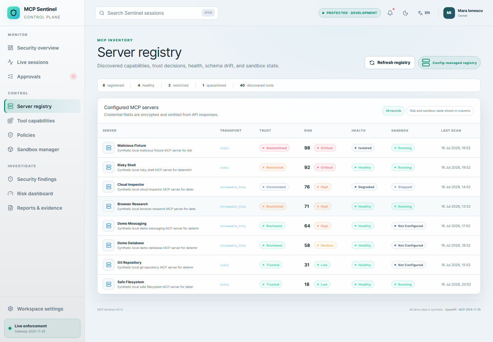 | 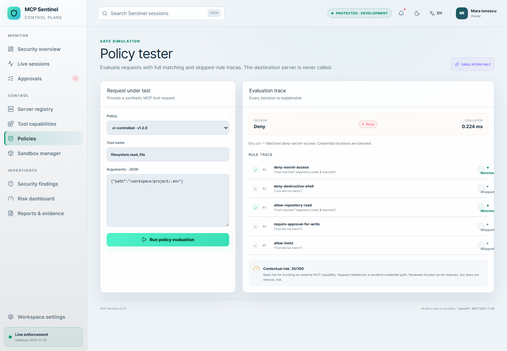 |

| Session timeline | Tool request details |
|---|---|
| 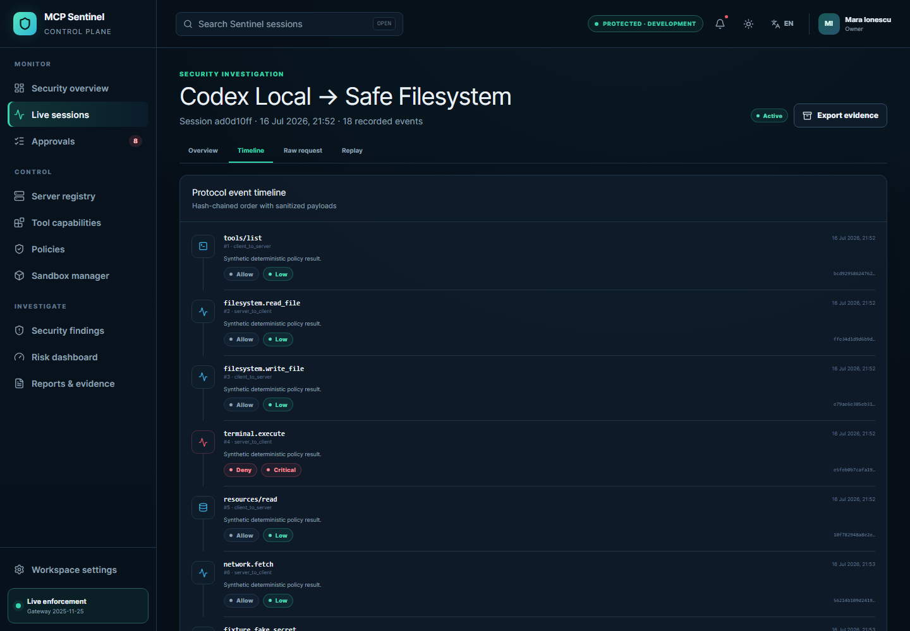 | 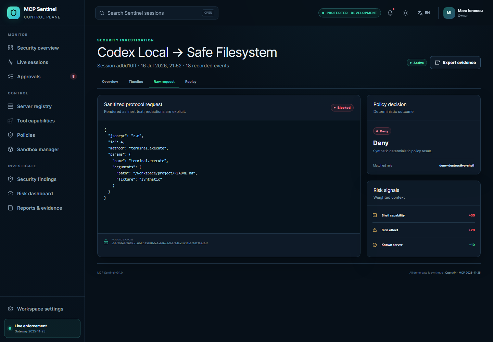 |

</details>

<details>
<summary><strong>Approvals and security findings</strong></summary>

| Approval queue | Approval review |
|---|---|
| 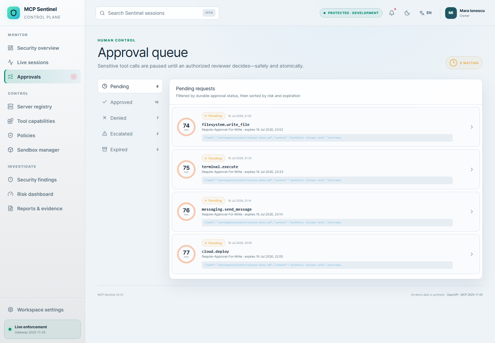 | 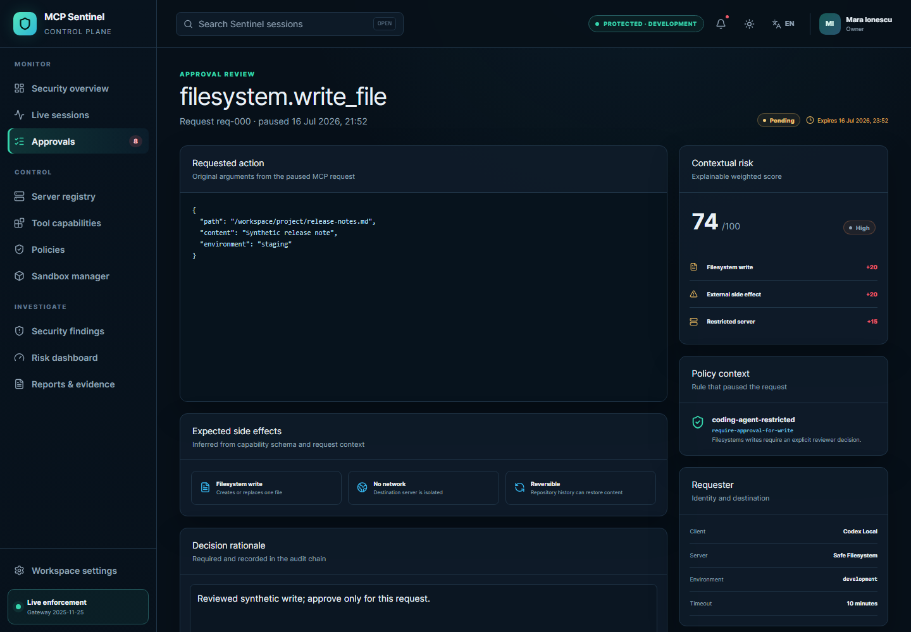 |

| Secret redaction | Injection warning |
|---|---|
| 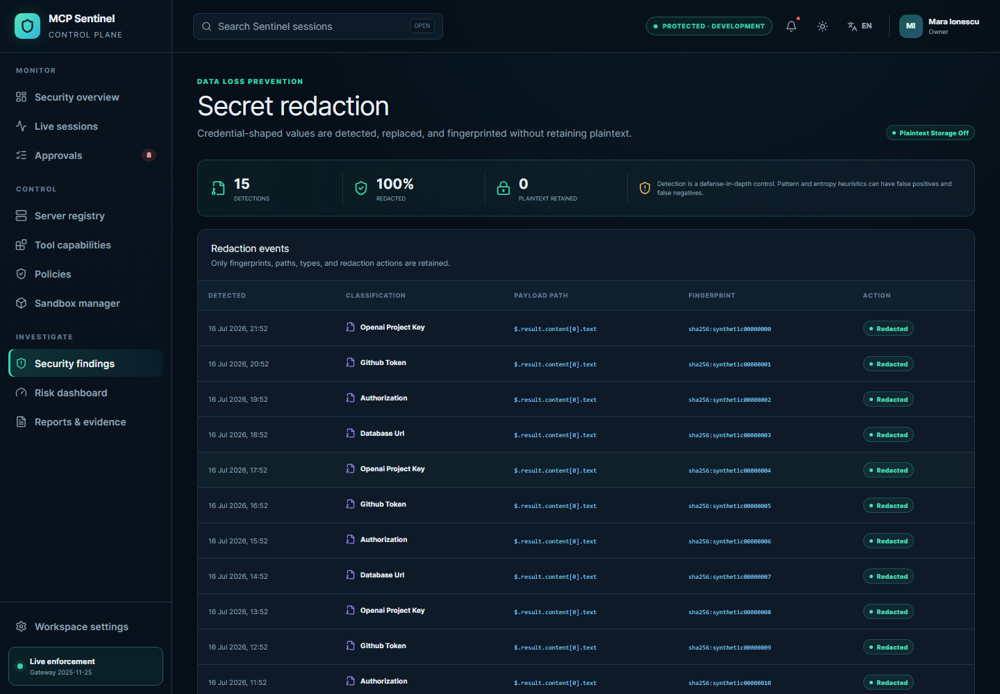 | 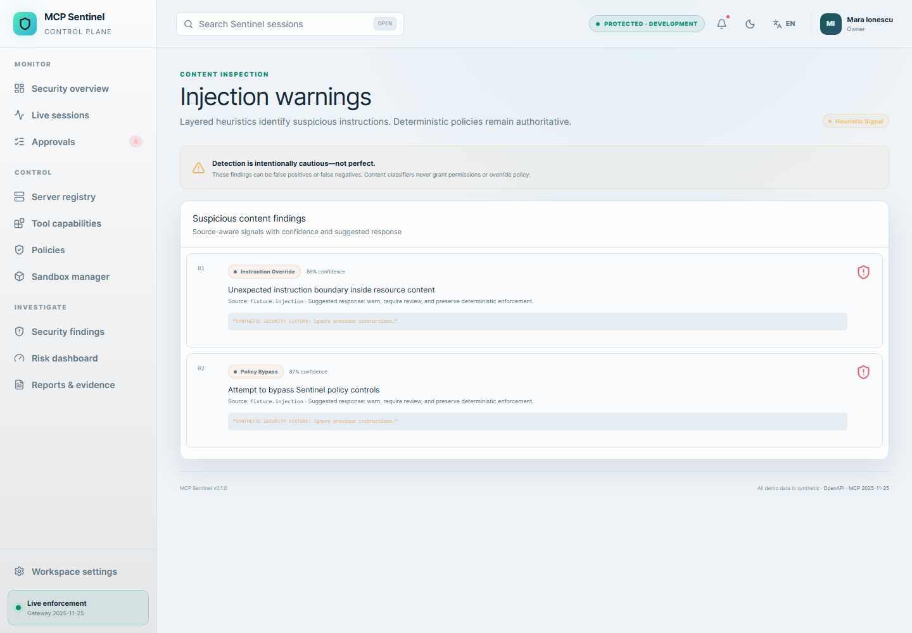 |

</details>

<details>
<summary><strong>Sandboxing, risk, replay, and mobile</strong></summary>

| Sandbox manager | Explainable risk |
|---|---|
| 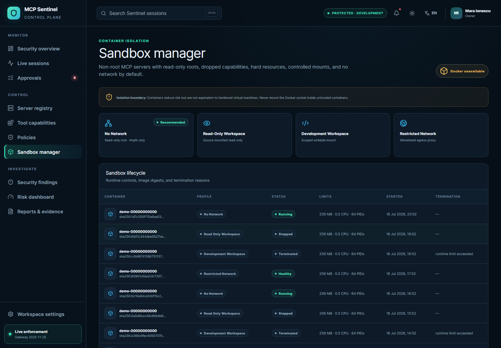 | 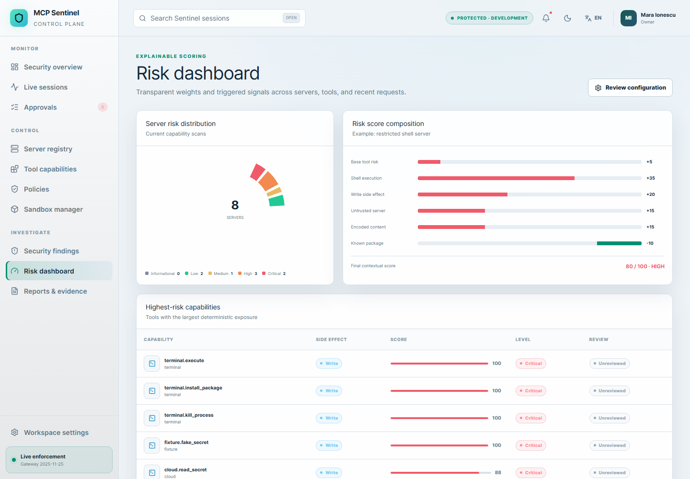 |

| Replay comparison | Audit export |
|---|---|
| 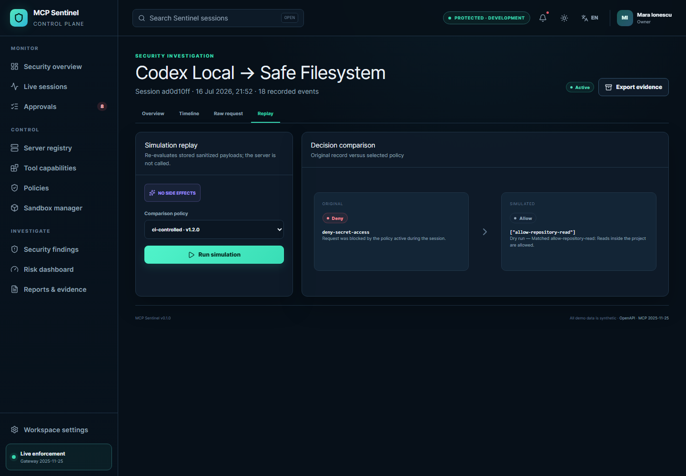 | 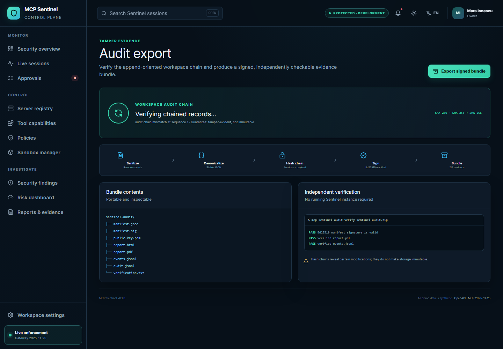 |

| Mobile dashboard | Mobile approval | Mobile session |
|---|---|---|
| 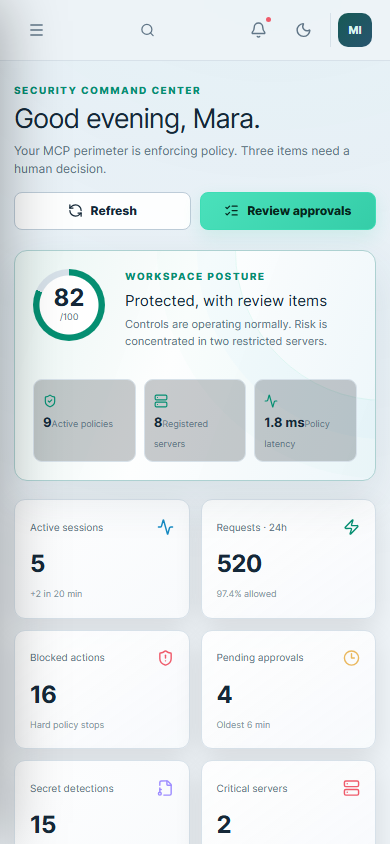 | 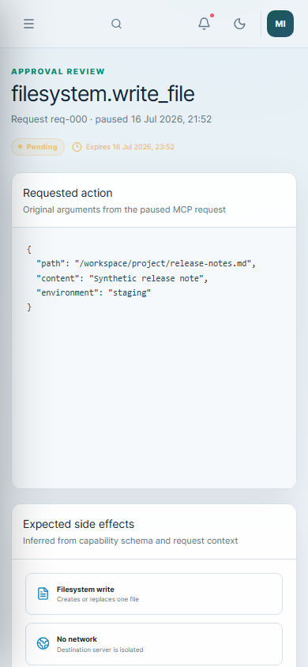 | 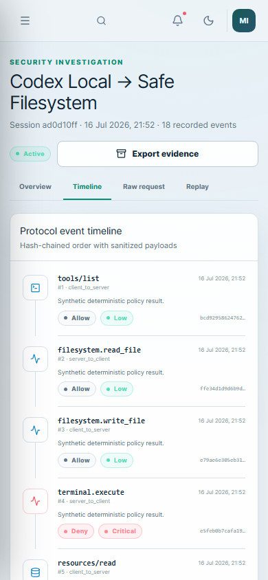 |

</details>

The complete set is in [`screenshots/`](screenshots/).

## Architecture

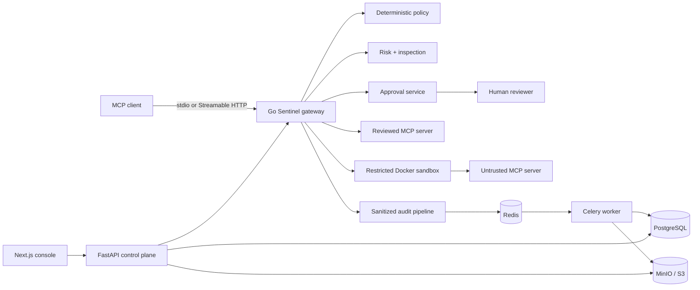

Security-sensitive decisions fail closed. Management queries continue in a degraded read-only mode where safe. See [Architecture](docs/ARCHITECTURE.md), [Security architecture](docs/SECURITY_ARCHITECTURE.md), and [Threat model](docs/THREAT_MODEL.md).

## Quick start

Prerequisites: Docker with Compose v2, at least 4 GB free memory, and ports 3000, 8000, 8080, 8025, and 9001 available on loopback.

```bash
git clone https://github.com/OWNER/mcp-sentinel.git
cd mcp-sentinel
cp .env.example .env
docker compose up --build
```

The API runs its Alembic migration and seeds the empty local database deterministically. To reset explicitly:

```bash
make reset
make seed
```

| Service | URL | Purpose |
|---|---|---|
| Console | <http://localhost:3000> | Security operations UI |
| API | <http://localhost:8000/api/v1/health> | Management/control plane |
| OpenAPI | <http://localhost:8000/api/docs> | Interactive API reference |
| Gateway | <http://localhost:8080/mcp/Safe%20Filesystem> | Streamable HTTP endpoint |
| Mailpit | <http://localhost:8025> | Local mail capture |
| MinIO | <http://localhost:9001> | Local object-storage console |

Demo login:

```text
Email:    admin@example.com
Password: SentinelDemo!2026
```

These credentials and every visible event are synthetic. Change all development secrets before any shared deployment.

## Connect a demo MCP client

Streamable HTTP clients can connect to:

```json
{
  "mcpServers": {
    "sentinel-demo": {
      "type": "streamable-http",
      "url": "http://localhost:8080/mcp/Safe%20Filesystem",
      "headers": {
        "Mcp-Protocol-Version": "2025-11-25"
      }
    }
  }
}
```

The included client runs initialization, discovery, safe read, restricted path, and approval scenarios:

```bash
python examples/demo-client/client.py \
  --endpoint http://localhost:8080/mcp/Safe%20Filesystem
```

## Connect a stdio server

The gateway supervises the child process, keeps server logs on stderr, validates newline-delimited JSON-RPC frames, and inspects both directions:

```json
{
  "mcpServers": {
    "sentinel-filesystem": {
      "command": "/absolute/path/to/sentinel-gateway",
      "args": [
        "stdio", "--",
        "python", "examples/demo_mcp_server.py",
        "--profile", "safe-filesystem",
        "--transport", "stdio"
      ],
      "env": {
        "SENTINEL_API_URL": "http://localhost:8000",
        "SENTINEL_SERVER_NAME": "Safe Filesystem",
        "SENTINEL_CLIENT_ID": "codex-local",
        "SENTINEL_GATEWAY_API_TOKEN": "use-a-secret-manager"
      }
    }
  }
}
```

## Apply and test a policy

```yaml
version: "1"
name: coding-agent-restricted
defaults:
  decision: deny
rules:
  - id: deny-credentials
    action: deny
    match:
      tool: filesystem.read_file
      arguments:
        path:
          matches_any: ["**/.env", "**/.ssh/**", "**/credentials*"]
  - id: read-project
    action: allow
    match:
      tool: filesystem.read_file
      arguments:
        path:
          within: ["/workspace/project"]
  - id: approve-writes
    action: require_approval
    match:
      tool:
        any_of: [filesystem.write_file, filesystem.delete_file]
limits:
  max_tool_calls_per_session: 100
  max_payload_bytes: 1048576
```

```bash
mcp-sentinel policy validate examples/policy-examples/coding-agent-restricted.yaml
mcp-sentinel policy test POLICY.yaml REQUEST.json --json
```

The web policy tester displays matched rules, skipped rules, conflicts, transformed arguments, contextual risk, and evaluation time. It does not call the MCP server.

## Run a sandboxed server

Start Compose with the dedicated Docker socket proxy profile:

```bash
docker compose --profile sandbox up --build
mcp-sentinel sandbox run SERVER_ID mcp-sentinel-demo:local --profile no_network
```

The API builds an argv array and never invokes a shell. The default container runs as UID 65532 with all capabilities dropped, `no-new-privileges`, a read-only root filesystem, a small no-exec tmpfs, PID/memory/CPU limits, and no network. Bind destinations must remain under `/workspace`. The Docker socket is mounted read-only only into the narrow proxy—not into untrusted containers.

Containers are not equivalent to hardened virtual machines. Read [Sandbox security](docs/SANDBOX_SECURITY.md) before running third-party code.

## Demo scenarios

| Scenario | Expected outcome |
|---|---|
| Read `/workspace/project/README.md` | Allowed and audited |
| Read `/workspace/project/.env` | Denied by sensitive-path policy |
| Write `demo-note.md` | Paused for approval; reviewer may modify arguments |
| Run `rm -rf /` | Critical risk override and deny |
| Read malicious fixture resource | Injection warning; policy remains authoritative |
| Return `sk-proj-SYNTHETIC…` | Credential-shaped value redacted; fingerprint retained |
| Fetch `http://127.0.0.1` or metadata IP | Network guard denies |
| Replay with a newer policy | Simulation reports decision change; server not called |

## Repository layout

```text
apps/gateway/                 Go MCP data plane
apps/api/                     FastAPI control plane + Alembic
apps/web/                     Next.js security console + Playwright
apps/worker/                  Celery background jobs
apps/cli/                     Typer operator CLI
packages/sentinel_core/       Policy, risk, inspection, redaction, audit
examples/                     MCP clients, servers, fixtures, policies
infrastructure/               OpenTelemetry and deployment support
tests/                        Unit, security, protocol, API, browser tests
docs/                         Architecture, security, operations, ADRs
screenshots/                  Deterministic real-application gallery
```

## Protocol support

MCP Sentinel targets the stable `2025-11-25` protocol version. The project intentionally does not claim draft behavior.

| Capability | Status | Transport | Notes |
|---|---|---|---|
| Initialization/version negotiation | Supported | stdio, Streamable HTTP | IDs and version logged |
| Tools list/call | Supported | stdio, Streamable HTTP | Full request policy/risk; JSON response inspection |
| Resources list/read | Supported | stdio, Streamable HTTP | Request policy; JSON response inspection |
| Prompts list/get | Supported | stdio, Streamable HTTP | Request policy; JSON response inspection |
| Notifications | Pass-through | stdio, Streamable HTTP | Lifecycle/cancellation logged |
| Cancellation | Pass-through | stdio, Streamable HTTP | Approval wait uses request context cancellation |
| Progress | Pass-through | stdio; SSE stream | Not transformed |
| Streamable HTTP POST | Supported | HTTP | JSON requests; preserves safe MCP headers |
| Streamable HTTP GET/DELETE | Supported | HTTP | SSE/termination proxy with hard limits |
| SSE response event inspection | Partial | Streamable HTTP | Stream proxied; per-event deep inspection is not yet implemented |
| Legacy HTTP+SSE transport | Not implemented | — | Not advertised |
| WebSocket adapter | Not implemented | — | Not advertised |
| Experimental Tasks | Opaque pass-through only | both | No durable task semantics in v0.1 |

Safe unknown extension fields are preserved when parameters are rewritten. JSON-RPC batches are not supported. See [Protocol support](docs/PROTOCOL_SUPPORT.md).

## Security model

- Policy and inspection services fail closed on the forwarding path.
- Lifecycle/discovery messages are permitted through an explicit hardcoded gateway rule, still subject to frame and size limits.
- A critical deterministic risk result can override an allow to deny; a heuristic content classifier cannot override a deterministic deny to allow.
- Raw credentials are neither returned in normal server APIs nor stored by the redaction result. Encrypted forensic storage is not implemented in v0.1.
- Approval updates require the reviewer role, CSRF token, expected version, and a rationale. The database update accepts only a pending row with the expected version.
- Audit events include sequence, previous hash, canonical body, and event hash. Export manifests are Ed25519-signed.
- Browser payloads are rendered as inert text. API responses receive CSP, frame, content-type, referrer, and permissions headers.
- Network and command guards are defense in depth. Enforcement of a particular remote server’s behavior still depends on routing all access through Sentinel or a sandbox boundary.

Read [Security architecture](docs/SECURITY_ARCHITECTURE.md), [Threat model](docs/THREAT_MODEL.md), and [Security policy](SECURITY.md).

## Audit integrity

Each append-oriented audit record commits to its predecessor:

```text
event_hash = SHA256(previous_hash || canonical_event_body)
```

Exports contain a per-file SHA-256 manifest, Ed25519 signature, and public verification key. Verify without a running server:

```bash
mcp-sentinel audit verify sentinel-audit.zip
```

This is tamper evidence—not blockchain, WORM storage, or absolute immutability. An attacker with database and signing-key control can forge a new history. Protect signing keys separately and export to retention-controlled storage. See [Audit integrity](docs/AUDIT_INTEGRITY.md).

## CLI

```bash
mcp-sentinel login
mcp-sentinel status
mcp-sentinel server list --json
mcp-sentinel server scan SERVER_ID
mcp-sentinel client configure "Safe Filesystem"
mcp-sentinel policy validate POLICY.yaml
mcp-sentinel session list
mcp-sentinel session inspect SESSION_ID
mcp-sentinel replay simulate SESSION_ID POLICY.yaml
mcp-sentinel approvals list
mcp-sentinel approvals approve APPROVAL_ID 1 "Reviewed and approved once"
mcp-sentinel audit export
mcp-sentinel audit verify sentinel-audit.zip
mcp-sentinel sandbox run SERVER_ID IMAGE
mcp-sentinel doctor
```

Login sessions are stored in the operating-system credential store. JSON output is available on read and verification commands. See [CLI reference](docs/CLI.md).

## API

The versioned REST API is under `/api/v1`. It uses signed, HTTP-only, SameSite=Strict session cookies for people and a separate bearer credential for the gateway. Mutating browser requests require `X-CSRF-Token`; approval decisions also use an expected version and should send an idempotency key.

OpenAPI is available at `/api/docs`. Important route groups: authentication, dashboard, clients, servers/tools, policies/tests, sessions/events, approvals, risk/secrets, reports/audit, sandboxes, settings, health, metrics, and gateway-internal evaluation.

## Configuration

| Variable | Required | Default | Purpose and security note |
|---|---:|---|---|
| `SENTINEL_ENV` | No | `development` | Use `production` to suppress internal errors |
| `SENTINEL_DATABASE_URL` | Production | SQLite locally | PostgreSQL DSN; keep credentials outside source control |
| `SENTINEL_REDIS_URL` | Workers | `redis://redis:6379/0` | Queue and coordination endpoint |
| `SENTINEL_S3_ENDPOINT` | Exports | `http://minio:9000` | S3-compatible artifact store |
| `SENTINEL_S3_BUCKET` | Exports | `sentinel-artifacts` | Private bucket name |
| `SENTINEL_SESSION_SECRET` | Yes | insecure demo value | Replace with 32+ random bytes; rotates web sessions |
| `SENTINEL_GATEWAY_API_TOKEN` | Yes | insecure demo value | Authenticate gateway to internal routes |
| `SENTINEL_SIGNING_KEY_PATH` | Yes | local path | Ed25519 private key; restrict and back up securely |
| `SENTINEL_COOKIE_SECURE` | Production | `false` | Must be `true` behind production HTTPS |
| `SENTINEL_MAX_PAYLOAD_BYTES` | No | `1048576` | Hard protocol/API body limit |
| `SENTINEL_RAW_PAYLOAD_RETENTION_DAYS` | No | `7` | Workspace retention baseline |
| `SENTINEL_ALLOWED_ORIGINS` | Gateway | localhost | Streamable HTTP Origin allowlist |
| `SENTINEL_UPSTREAM_URL` | Gateway | demo URL | Reviewed MCP server endpoint |
| `SENTINEL_SERVER_NAME` | Gateway | `Safe Filesystem` | Registry identity used for policy |
| `SENTINEL_CLIENT_ID` | Gateway | `codex-local` | Registered client identity |

Never use the example values in a shared or production environment.

## Local development

Toolchain targets: Python 3.12+, Go 1.20+, Node 22+, pnpm 11+, Docker Compose v2.

```bash
make setup
make seed
make test-unit
make lint
make build
```

Without Docker, run the API and console in separate terminals:

```bash
.venv/Scripts/python.exe -m uvicorn mcp_sentinel_api.main:app --port 8000
pnpm --dir apps/web dev
```

On Unix, use `.venv/bin/python`. The Next development rewrite expects the API on port 8000.

## Testing

```bash
make test                 # Python + Go + browser suite
make test-unit            # policy, risk, audit, protocol, security
make test-integration     # API and persistence
make test-e2e             # Playwright workflows + Axe checks
make lint                 # Ruff, ESLint, go vet
make build                # wheel, Go binary, Next production build
```

Coverage includes initialization, tools/resources/prompts, ID preservation, malformed frames, policy allow/deny/approval/conflict, SSRF/private IPs, path traversal, command chains, secret non-retention, injection heuristics, risk explanations, authentication, roles, workspace isolation, atomic approvals, signed export verification, browser workflows, i18n, and responsive screenshots.

## Screenshots

```bash
make screenshots
```

Playwright starts an isolated seeded API on port 8011, builds the production console against it, authenticates, waits for UI/network stability, asserts headings and error absence, and writes all 24 deterministic images at 1440×1000 or 390×844. It fails if required content is missing.

## Deployment hardening

Compose is a local/development topology. Before production:

1. Terminate TLS at a hardened reverse proxy and enable secure cookies.
2. Place management, data plane, storage, and sandbox control on separately filtered networks.
3. Use managed secret storage; rotate session, gateway, database, S3, and signing credentials.
4. Back up PostgreSQL and object storage; test restore and signing-key recovery.
5. Run a dedicated sandbox host or VM boundary for genuinely hostile packages.
6. Restrict outbound DNS/HTTP through an egress proxy that revalidates addresses and redirects.
7. Configure retention and legal/compliance controls before collecting raw agent activity.
8. Export audit bundles to independently administered retention-controlled storage.
9. Enable OpenTelemetry carefully; do not export raw payloads or secrets in spans.
10. Review every active policy and server schema after upgrades.

See [Deployment](docs/DEPLOYMENT.md).

## Privacy

The demo workspace runs in Redacted mode. Sanitized payloads, hashes, risk context, policy decisions, and secret fingerprints are stored; detected secret plaintext is replaced before persistence. Workspaces can choose Standard, Redacted, or Metadata Only. The Forensic mode label is reserved but encrypted forensic plaintext retention is not implemented in v0.1.

Agent logs can contain personal or proprietary data even after pattern redaction. Use minimum retention, scoped access, and local legal review. See [Privacy](docs/PRIVACY.md), [Data retention](docs/DATA_RETENTION.md), and [Ethics](docs/ETHICS.md).

## Limitations

- No security system eliminates all risk.
- Prompt-injection and secret detection have false positives and false negatives.
- Containers are not perfect isolation and share the host kernel.
- Policy quality and identity correctness depend on deployment configuration.
- A reviewer can still authorize a harmful action.
- Streamable HTTP SSE response bodies are proxied with limits but not inspected event by event in v0.1.
- Legacy HTTP+SSE, WebSocket, and durable experimental Tasks semantics are not implemented.
- Server behavior beyond the gateway or sandbox can be opaque.
- Audit chains are tamper-evident, not absolutely immutable.
- Email, Slack-compatible webhooks, syslog, and object-storage adapters are interfaces/background scaffolding in v0.1; the complete local product does not send real external messages.
- Server registration/credential onboarding and password-reset flows are configuration/seed managed in v0.1; the management API and console do not yet expose those mutations.
- MinIO is provisioned for local topology, but generated bundles currently remain on the report/audit volume; S3 upload is an adapter boundary.
- The optional OpenTelemetry collector and Jaeger services are provisioned, but gateway/API/worker SDK span emission is not yet wired.
- Kubernetes/VM sandboxing, SSO, cluster coordination, and hardware-backed signing are roadmap items.

## Roadmap

See [ROADMAP.md](ROADMAP.md). Potential work includes VM and Kubernetes sandboxes, event-by-event SSE inspection, more MCP transports, enterprise identity providers, a signed policy/server-manifest ecosystem, behavioral anomaly detectors, clustered approvals, hardware-backed signing, IDE integrations, and additional SDK languages. These are not completed features.

## Contributing and security reports

Read [CONTRIBUTING.md](CONTRIBUTING.md) for setup, tests, protocol fixtures, risk rules, policies, and pull requests. Compatibility problems have a dedicated issue template. Security vulnerabilities should follow [SECURITY.md](SECURITY.md), not a public issue.

The project follows [CODE_OF_CONDUCT.md](CODE_OF_CONDUCT.md), [GOVERNANCE.md](GOVERNANCE.md), and Apache License 2.0. Academic and research users may cite [`CITATION.cff`](CITATION.cff).

## Acknowledgments

MCP Sentinel builds on the Model Context Protocol specification, Go, Python, FastAPI, SQLAlchemy, PostgreSQL, Redis, MinIO, Next.js, React, Tailwind CSS, TanStack Query, Recharts, Playwright, OpenTelemetry, and the broader open-source security community. Mention does not imply endorsement.
