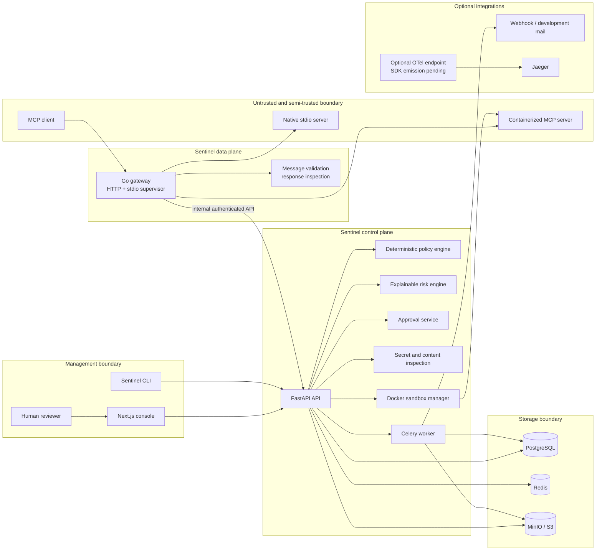
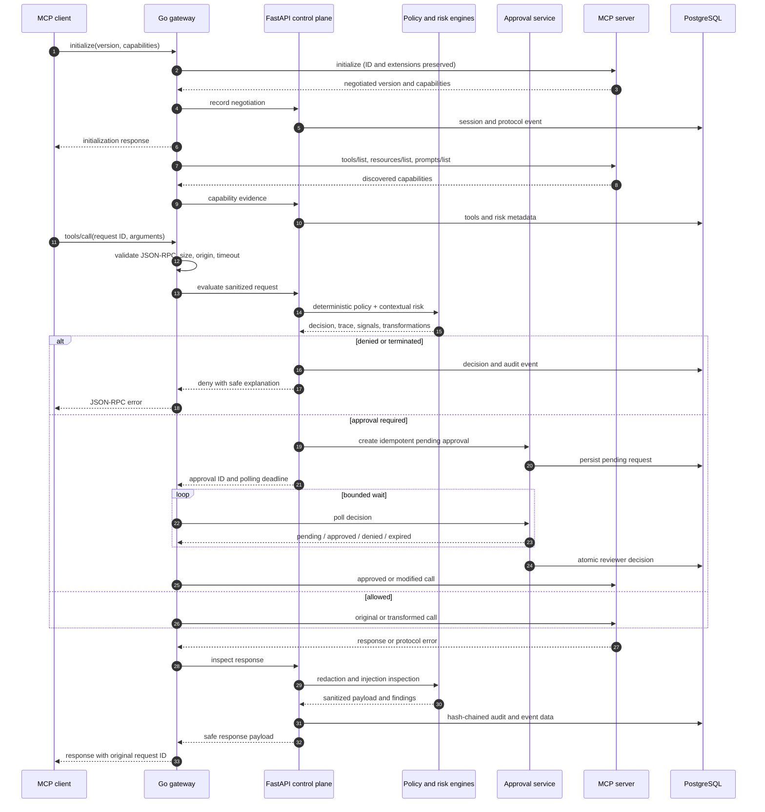
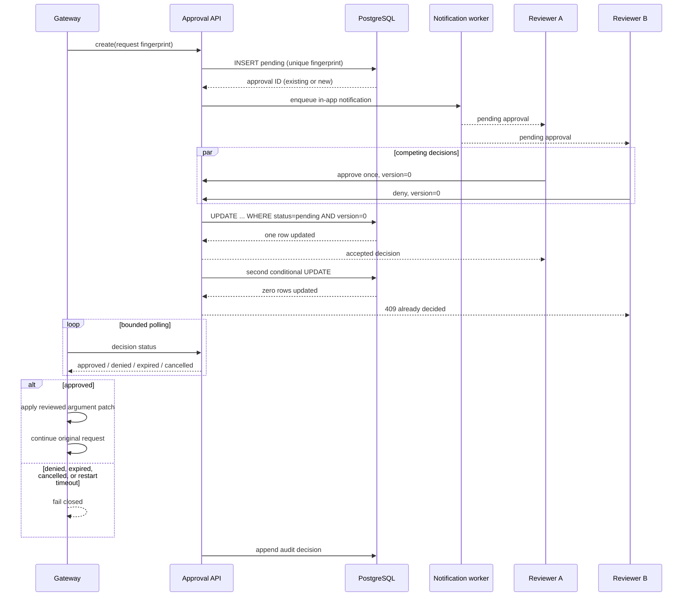
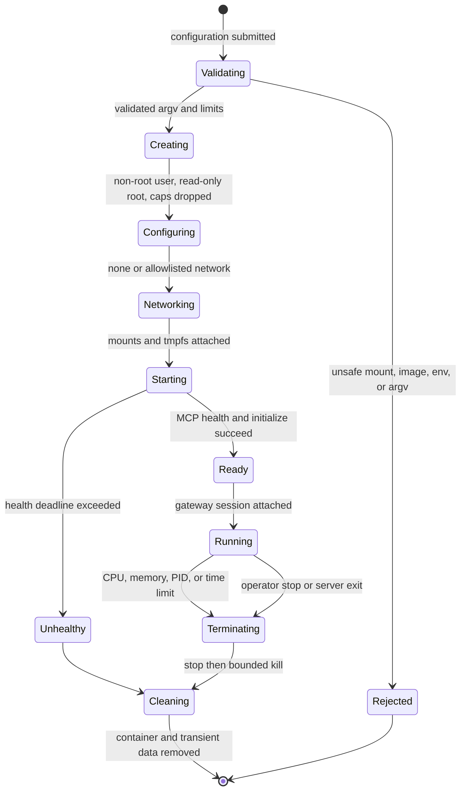
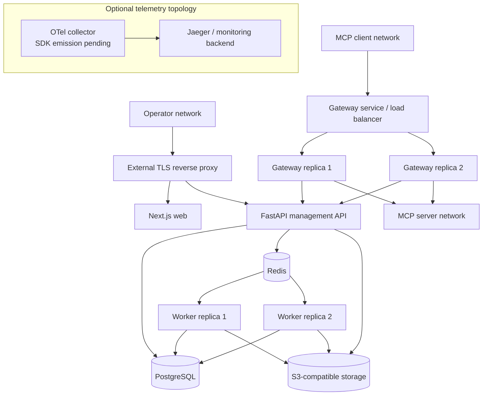
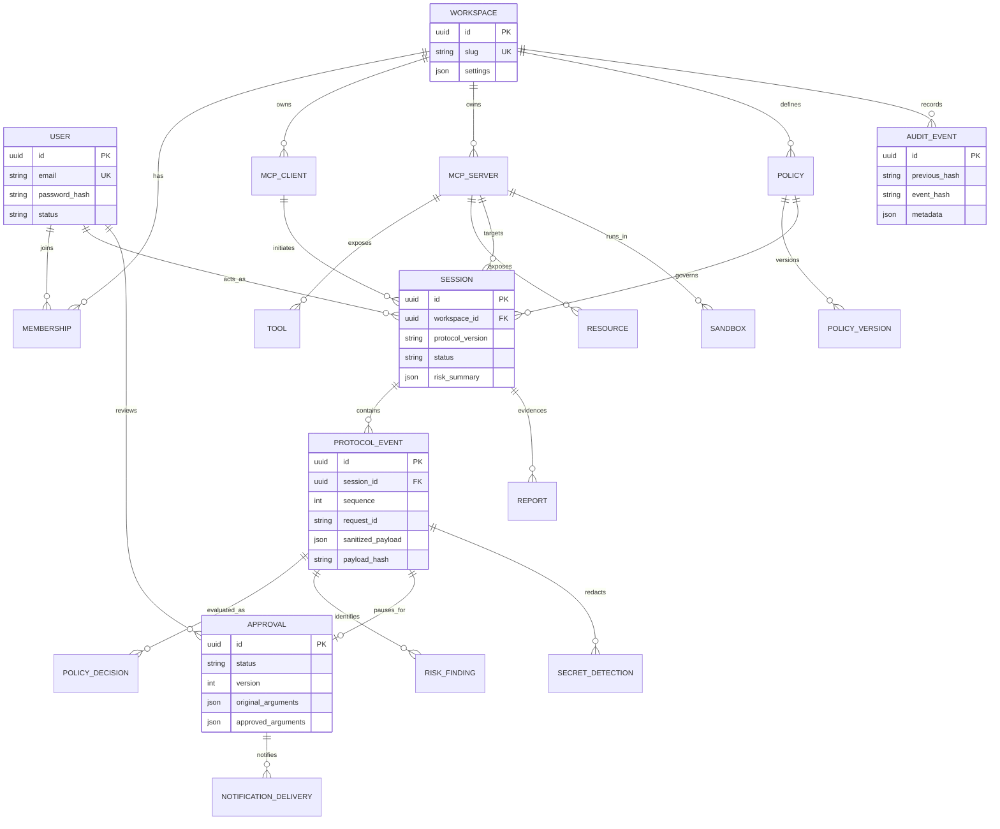

# Architecture

MCP Sentinel is a control plane and data-plane gateway for Model Context Protocol (MCP) traffic. The Go gateway is the enforcement point. FastAPI owns identities, configuration, policy evaluation, approval state, and durable records. The Next.js application is a management console; it is never on the trusted forwarding path.

## System context

## Request sequence

The gateway fails closed when the evaluation API is unavailable, malformed, or times out. Inspection-only mode still enforces hard message-size, origin, parser, and timeout limits.

## Approval sequence and races

Approval state is durable. A restarted gateway can resume polling by approval ID, but a request is never forwarded twice by the approval API; upstream servers still require their own idempotency for side-effecting calls.

## Sandbox lifecycle

The manager constructs an argument vector and uses the Docker API; it does not interpolate a shell command. The Compose sandbox profile grants a restricted Docker socket proxy rather than mounting the daemon socket directly into the API. See [Sandbox security](SANDBOX_SECURITY.md).

## Audit data flow

```mermaid
flowchart LR
    Event[Protocol or management event] --> Sanitize[Classify and redact]
    Sanitize --> Canon[Canonical JSON serialization]
    Canon --> Chain[SHA-256 of previous hash + event]
    Chain --> DB[(Append to PostgreSQL)]
    DB --> Select[Authorized report selection]
    Select --> Bundle[JSONL + HTML + Markdown + PDF]
    Bundle --> Digest[Artifact SHA-256 manifest]
    Digest --> Sign[Ed25519 signature]
    Sign --> Store[(MinIO / S3 or local artifact)]
    Store --> Verify[Offline CLI verifier]
    Verify --> Result[Chain, hashes, signature result]
```

The chain is tamper-evident, not immutable: an actor controlling the database and signing key can replace history. Production deployments should isolate signing material and copy exports to immutable retention storage.

## Deployment

The repository's Compose deployment uses one replica of each service plus Mailpit, MinIO, PostgreSQL, and Redis. The optional collector/Jaeger profile is a deployment extension point; application SDK span emission is not wired in v0.1. TLS termination, production key management, backups, and a real secret provider are operator responsibilities.

## Data model

The current SQLAlchemy schema combines some logical records—policy versions are represented by policy version fields, policy/risk decisions live on protocol events, and notification delivery is handled by worker adapters. The diagram makes these logical relationships explicit without claiming separate physical tables where none exist.

## Trust boundaries

| Boundary | Trusted inputs | Controls | Residual risk |
|---|---|---|---|
| User browser | Authenticated user actions | HttpOnly signed session, SameSite cookie, CSRF, RBAC | Compromised browser or approved harmful action |
| Management API | Validated JSON and authorized identity | Pydantic validation, workspace scoping, roles, audit | API/runtime compromise |
| MCP client | JSON-RPC frames | size limits, JSON validation, origin checks, timeouts | semantic abuse and extension ambiguity |
| Gateway | Compiled configuration and internal API | fail-closed enforcement, fixed deadlines, ID preservation | gateway host compromise |
| MCP server | Protocol responses | response inspection, redaction, timeout, sandbox option | opaque behavior and covert channels |
| Sandbox | Explicit image, argv, mounts, limits | non-root, dropped capabilities, network policy, resource limits | container escape or kernel exploit |
| Container runtime | Docker API | optional socket proxy, least privileges | daemon compromise controls host |
| Data storage | Sanitized records | encryption-in-transit/deployment, redaction, retention, hashes | privileged database access |
| Notification | Sanitized approval summary | adapter boundary, no plaintext secrets | third-party retention and metadata |
| Observability | Labels and sanitized traces | no raw payloads by default | high-cardinality or accidental custom labels |

## Failure modes

| Failure | Enforcement behavior | Recovery |
|---|---|---|
| Gateway unavailable | Connection fails closed | client retry or another replica |
| Policy API/engine unavailable | sensitive request denied | restore API; no bypass is automatic |
| PostgreSQL unavailable | new durable decisions denied; reads may fail | restore primary, verify audit sequence |
| Redis unavailable | synchronous gateway checks continue; jobs/notifications queue locally or fail visibly | restore Redis and requeue idempotent jobs |
| Reviewer unavailable | approval expires and request is denied | assign reviewer or resubmit request |
| MCP server timeout | bounded gateway error, session remains auditable | health-check or restart server |
| Sandbox startup failure | no connection is exposed | inspect sanitized build/runtime log |
| Audit persistence backlog | gateway rejects when durable evidence is required | drain worker queue and monitor lag |
| Object storage unavailable | live enforcement continues; exports remain pending | retry report job |
| OTel unavailable | product continues; telemetry is dropped/buffered | restore collector; audit records remain authoritative |

Fail-open is intentionally not implemented for security-sensitive evaluation. Operators may use development inspect mode, which records non-critical policy findings but retains structural safety limits.

## Scaling strategy

- Run stateless gateway replicas behind an MCP-aware load balancer. Long-lived streams need connection affinity for their lifetime.
- Cache compiled, version-keyed policies in each gateway/API process and invalidate via Redis pub/sub or version polling.
- Coordinate approvals and idempotency in PostgreSQL; Redis is acceleration and job transport, not the approval source of truth.
- Batch protocol-event inserts while preserving per-session sequence order and audit hashes.
- Partition high-volume protocol events by workspace/time and archive sanitized payload artifacts to object storage.
- Scale Celery workers by queue (reports, retention, sandbox builds, notifications), each with idempotent job keys.
- Use object storage lifecycle rules for report and large-payload retention.
- Export bounded-cardinality metrics for decisions, latency, denials, queue depth, and sandbox failures.

## Repository components

| Path | Responsibility |
|---|---|
| `apps/gateway` | Go data-plane proxy and stdio supervisor |
| `apps/api` | FastAPI management/evaluation API and migrations |
| `apps/web` | Next.js management console |
| `apps/worker` | Celery asynchronous work |
| `apps/cli` | Typer operator commands and audit verifier |
| `packages/sentinel_core` | Policy, risk, inspection, redaction, and audit primitives |
| `examples` | Synthetic MCP servers, client, policies, and demo workspace |
| `tests` | Unit, protocol, backend, and security tests |

## Related decisions

Architecture choices are captured in [`docs/adr`](adr/README.md). Security details are in [Security architecture](SECURITY_ARCHITECTURE.md), [Threat model](THREAT_MODEL.md), and [Protocol support](PROTOCOL_SUPPORT.md).
